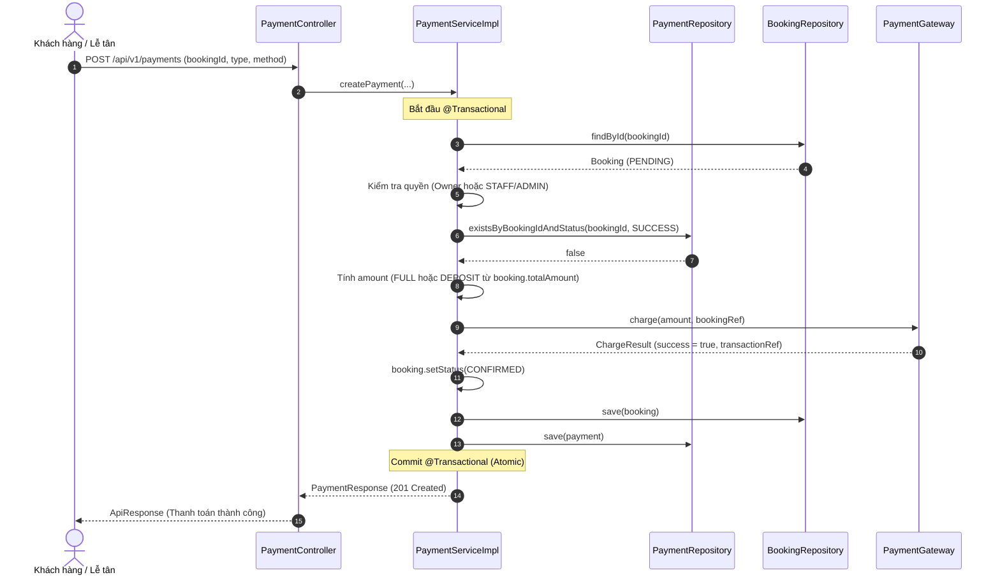

# CHI TIẾT MODULE 6: PAYMENTS & REFUNDS (QUẢN LÝ THANH TOÁN & HOÀN TIỀN)

> **Dành cho:** AI Coding Agents và Backend Developers  
> **Phạm vi:** Nghiệp vụ thanh toán mô phỏng (Mock Gateway), thanh toán toàn phần / đặt cọc, chuyển trạng thái đặt sân đồng bộ và quy trình hoàn tiền tự động hủy lịch (Soft Cancel).

---

## 1. Bài Toán Nghiệp Vụ Giải Quyết (Problems Solved)

1. **Khép kín vòng đời đặt sân trực tuyến (Completing the Online Booking Lifecycle):**
   - Ở Module 4, đơn đặt sân online của khách hàng dừng lại ở trạng thái **`PENDING`** (giữ chỗ tạm thời).
   - Module 6 cung cấp endpoint thanh toán `POST /api/v1/payments`, cho phép khách hàng thanh toán cho đơn của mình hoặc nhân viên lễ tân thu tiền trực tiếp.
   - Khi thanh toán thành công, đơn đặt sân được chuyển sang **`CONFIRMED`** một cách đồng bộ trong cùng một transaction `@Transactional`.

2. **Hỗ trợ thanh toán linh hoạt (Full Payment & Deposit Support):**
   - Hỗ trợ 2 hình thức thanh toán theo nhu cầu thực tế:
     - **`FULL`**: Thanh toán 100% tổng tiền đơn đặt sân.
     - **`DEPOSIT`**: Đặt cọc 50% tổng tiền (làm tròn 2 chữ số thập phân, `HALF_UP`).
   - Đa dạng phương thức thanh toán: Tiền mặt (`CASH`), Chuyển khoản ngân hàng (`BANK_TRANSFER`), Ví điện tử (`E_WALLET`).

3. **An toàn tài chính & Chống gian lận (Financial Safety & Anti-Fraud):**
   - Loại bỏ hoàn toàn rủi ro sửa giá từ phía client bằng cách tính toán số tiền `amount` 100% tại server-side dựa trên `booking.totalAmount` đã snapshot từ trước.
   - Cơ chế bảo vệ kép chống thanh toán trùng lặp (Double-Charge Protection) thông qua kiểm tra trạng thái đơn đặt sân (`booking.status == PENDING`) và kiểm tra lịch sử thanh toán thành công (`existsByBookingIdAndStatus(bookingId, SUCCESS)`).

4. **Quy trình hoàn tiền an toàn & Bảo toàn lịch sử (Safe Refund & Audit Trail):**
   - Chỉ cấp quyền cho Lễ tân (`STAFF`) và Quản trị viên (`ADMIN`) thực hiện hoàn tiền qua `POST /api/v1/payments/{id}/refund`.
   - Chặn hoàn tiền nếu khách đã nhận sân (`CHECKED_IN`) hoặc buổi chơi đã hoàn tất (`COMPLETED`).
   - Khi hoàn tiền thành công, giao dịch chuyển sang `REFUNDED` và đơn đặt sân tự động chuyển sang `CANCELLED` (Soft Cancel) để lập tức giải phóng khung giờ cho khách khác, đồng thời lưu vết lý do hoàn tiền vào trường `note`.

---

## 2. Ba Quyết Định Thiết Kế Cốt Lõi (Key Architectural Decisions)

### 2.1. Vì sao tách interface `PaymentGateway` thay vì gọi trực tiếp cổng thanh toán?
- **Tuân thủ nguyên tắc Dependency Inversion (DIP) và Open/Closed (OCP):**
  - Trong dự án học tập hoặc giai đoạn phát triển ban đầu, việc đăng ký pháp nhân doanh nghiệp để lấy API key thật từ VNPay, MoMo hay ZaloPay là bất khả thi.
  - Bằng cách định nghĩa abstraction `PaymentGateway` với phương thức `charge(BigDecimal amount, String bookingRef)` và triển khai `MockPaymentGateway` (@Component), tầng nghiệp vụ `PaymentServiceImpl` chỉ phụ thuộc vào contract trừu tượng.
  - Sau này khi tích hợp cổng thanh toán thật (VNPay, MoMo, Stripe), ta chỉ cần tạo class mới hiện thực `PaymentGateway` (hoặc áp dụng Strategy/Factory Pattern) mà không phải sửa đổi bất kỳ dòng code nào trong `PaymentServiceImpl`.
- **Hỗ trợ Unit Test độc lập và ổn định:**
  - `PaymentServiceTest` có thể dễ dàng mock `PaymentGateway` bằng Mockito để kiểm thử toàn diện mọi tình huống nghiệp vụ mà không cần mạng Internet hay phụ thuộc vào sự sẵn sàng của dịch vụ bên thứ ba.

### 2.2. Vì sao `amount` bắt buộc phải tính toán Server-side thay vì nhận từ Client?
- **Nguyên tắc cốt tử về bảo mật tài chính (Zero-Trust Client Input):**
  - Nếu API cho phép client gửi trường `amount` trong request body, bất kỳ người dùng nào có kiến thức cơ bản về DevTools hoặc Postman đều có thể can thiệp vào HTTP request để gửi `amount = 1 VND` hoặc thậm chí số âm.
  - Nếu server tin tưởng giá trị này và ghi nhận giao dịch, hệ thống sẽ bị thất thoát tài chính nghiêm trọng.
- **Tính toàn vẹn của dữ liệu (Data Consistency):**
  - Khi tạo đơn đặt sân ở Module 4, hệ thống đã snapshot chính xác `booking.totalAmount` dựa trên đơn giá giờ chơi của khung giờ và số giờ chơi.
  - Do đó, số tiền cần thanh toán phải là giá trị bất biến được suy ra từ chính đơn đặt sân: `FULL` = `booking.totalAmount` và `DEPOSIT` = `booking.totalAmount * 0.5`. Client chỉ được phép gửi "Ý định thanh toán" (`PaymentType`), không được phép quyết định giá trị thanh toán.

### 2.3. Vì sao khi Hoàn tiền (Refund) lại tự động chuyển trạng thái `booking.status -> CANCELLED`?
- **Tính nhất quán nghiệp vụ (Business Logic Consistency):**
  - Tiền bạc và quyền sử dụng sân luôn gắn liền với nhau. Một khi sân bãi đã hoàn trả lại tiền thanh toán hoặc tiền đặt cọc cho khách, khách hàng đương nhiên không còn quyền chiếm giữ khung giờ thi đấu đó nữa.
- **Tối ưu hóa công suất lấp đầy sân (Court Availability Maximization):**
  - Thuật toán kiểm tra lịch trống ở Module 4 (`findActiveBookingsByDateAndCourtIds`) coi các đơn mang trạng thái `CANCELLED` là slot trống.
  - Do đó, việc tự động chuyển `booking.status = CANCELLED` ngay trong cùng transaction của thao tác hoàn tiền sẽ lập tức giải phóng khung giờ trên lịch thi đấu để những khách hàng khác có thể tìm kiếm và đặt sân ngay lập tức.
- **Bảo toàn dữ liệu kiểm toán (Soft Cancel vs Hard Delete):**
  - Hệ thống không xóa dòng trong bảng `bookings` hay `payments`. Cả hai bản ghi đều được giữ lại nguyên vẹn với trạng thái `REFUNDED` và `CANCELLED`, kèm mốc thời gian và lý do hoàn tiền phục vụ cho công tác đối soát doanh thu và kiểm toán kế toán.

---

## 3. Phân Tích Áp Dụng 5 Nguyên Tắc SOLID

| Nguyên tắc SOLID | Biểu hiện cụ thể trong Module 6 | Lợi ích đạt được |
|---|---|---|
| **S - Single Responsibility Principle** | - `PaymentServiceImpl` chỉ đảm nhiệm logic nghiệp vụ thanh toán và hoàn tiền.<br>- `MockPaymentGateway` chỉ đảm nhiệm mô phỏng giao tiếp cổng thanh toán.<br>- `PaymentMapper` chỉ đảm nhiệm chuyển đổi Entity $\leftrightarrow$ DTO.<br>- `PaymentController` chỉ định tuyến HTTP, validate request và phân quyền. | Code có ranh giới rõ ràng, dễ bảo trì, dễ viết test mà không bị lẫn lộn trách nhiệm. |
| **O - Open/Closed Principle** | - `PaymentGateway` cho phép mở rộng thêm các cổng thanh toán mới (`VNPayGateway`, `MoMoGateway`, `StripeGateway`) mà không làm thay đổi code của `PaymentServiceImpl`.<br>- Hệ thống Enums (`PaymentType`, `PaymentMethod`, `PaymentStatus`) dễ dàng bổ sung giá trị mới khi mở rộng quy mô. | Mở rộng tính năng thanh toán mà không sợ gây ra lỗi hồi quy (regression bugs). |
| **L - Liskov Substitution Principle** | - Mọi implementation của `PaymentGateway` (bao gồm `MockPaymentGateway` hiện tại hoặc các Gateway thật sau này) đều tuân thủ hợp đồng trả về `ChargeResult`, có thể thay thế cho nhau tại runtime mà không phá vỡ hoạt động của Service. | Đảm bảo tính khả chuyển và hoán đổi linh hoạt giữa môi trường Test, Staging và Production. |
| **I - Interface Segregation Principle** | - `PaymentGateway` được thiết kế tối giản, tập trung vào phương thức cốt lõi `charge(...)`.<br>- Request DTO phân tách mạch lạc: `CreatePaymentRequest` (thanh toán) và `RefundPaymentRequest` (hoàn tiền), không chứa trường dư thừa. | Client và các component triển khai không bị ép buộc phụ thuộc vào các phương thức hay dữ liệu không dùng đến. |
| **D - Dependency Inversion Principle** | - `PaymentServiceImpl` phụ thuộc vào interface `PaymentGateway`, hoàn toàn không phụ thuộc trực tiếp vào lớp cụ thể `MockPaymentGateway`.<br>- Toàn bộ dependency được tiêm qua Constructor Injection (`@RequiredArgsConstructor`), không dùng `@Autowired` trên field. | Giúp module đạt mức độ khớp nối lỏng (loose coupling) tối đa, dễ dàng cô lập và viết Unit Test với Mockito. |

---

## 4. Kiểm Soát An Toàn Dữ Liệu & Giao Dịch (Transactional Integrity)



- **Tính nguyên tử (Atomicity):** Cập nhật trạng thái `Payment` thành `SUCCESS` và `Booking` thành `CONFIRMED` diễn ra trong cùng một transaction `@Transactional`. Nếu có bất kỳ lỗi nào xảy ra trong quá trình lưu dữ liệu, toàn bộ thay đổi sẽ được rollback 100%, bảo đảm không có tình trạng "tiền đã trừ mà sân chưa xác nhận".
- **Bảo vệ chống thanh toán lặp (Idempotency Guard):** Khóa trạng thái đơn đặt sân bằng cách chỉ chấp nhận `booking.status == PENDING` kết hợp query `existsByBookingIdAndStatus(bookingId, SUCCESS)`.

---

## 5. Danh Mục Thành Phần Code (Code Inventory)

```
src/main/java/com/badminton/
├── modules/payment/
│   ├── PaymentController.java (REST API: POST /, POST /{id}/refund)
│   ├── dto/
│   │   ├── request/
│   │   │   ├── CreatePaymentRequest.java (DTO gửi yêu cầu thanh toán)
│   │   │   └── RefundPaymentRequest.java (DTO gửi yêu cầu hoàn tiền)
│   │   └── response/
│   │       └── PaymentResponse.java (DTO trả về thông tin giao dịch)
│   ├── entity/
│   │   ├── Payment.java (JPA Entity bảng payments)
│   │   ├── PaymentType.java (Enum: FULL, DEPOSIT)
│   │   ├── PaymentMethod.java (Enum: CASH, BANK_TRANSFER, E_WALLET)
│   │   └── PaymentStatus.java (Enum: PENDING, SUCCESS, FAILED, REFUNDED)
│   ├── gateway/
│   │   ├── PaymentGateway.java (Interface cổng thanh toán trừu tượng)
│   │   ├── ChargeResult.java (Record kết quả thanh toán)
│   │   └── MockPaymentGateway.java (Triển khai mô phỏng Mock Gateway)
│   ├── mapper/
│   │   └── PaymentMapper.java (MapStruct chuyển đổi Payment -> PaymentResponse)
│   ├── repository/
│   │   └── PaymentRepository.java (Spring Data JPA Repository)
│   └── service/
│       ├── PaymentService.java (Interface nghiệp vụ thanh toán)
│       └── impl/PaymentServiceImpl.java (Triển khai nghiệp vụ thanh toán & hoàn tiền)
└── shared/exception/
    └── ErrorCode.java (Bổ sung PAYMENT_NOT_FOUND, BOOKING_NOT_PAYABLE, BOOKING_ALREADY_PAID, REFUND_NOT_ALLOWED)
```
